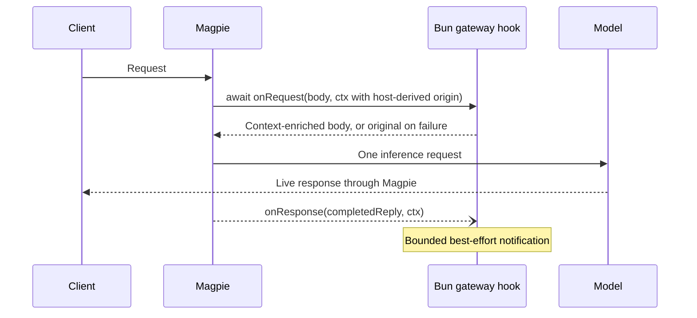

# Asynchronous gateway hooks

Opt-in Bun hooks add external context before routing and observe completed replies.
The gateway makes one model request per client request. Tool declarations, tool
execution and subsequent inference rounds belong to the client.



## Entry and request contract

Declare `"magpie": {"hooks": "./context.hooks.ts"}` in package.json,
or install a `*.hooks.js`, `.mjs`, `.ts` or `.mts` file using `magpie plugin add`.
The names are apart from the JS gateway middleware's (`magpie.middleware`,
its alias `magpie.gateway`, `*.gateway.js`), so a hook that imports `node:fs`
is never also loaded as middleware.
Bun runs TypeScript directly. A gateway-only package does not need provider
main/exports, a client MCP installation, or a client skill.

`export async function onRequest(body, ctx)` receives the client protocol JSON
before routing. Return a JSON object to add context; return `undefined` to keep
it. Mutations are rolled back when a hook throws, times out, returns invalid data,
or changes client tool declarations, tool choice, `model` or `stream` (the
gateway checked the caller's key against the model, and the client reads the
reply it asked for). A rolled-back hook counts as failed and gets no `onResponse`
for that request. It cannot reject requests or register tools. The synchronous middleware API remains available separately.

Context fields: `protocol` (`chat`, `responses`, `anthropic`, `gemini`), `model`,
`stream`, `path`, `origin`, `agent`, `session`, `cwd`, `query`, package `options`, private
request `state`, an `AbortSignal` and `report(code, bytes)`. Headers and client
credentials are not forwarded to the hook. Query extraction keeps original model
input intact while excluding client environment/instruction notices from recall.
Empty identity fields must not be interpreted as authenticated user identity.

`origin` is host-derived: `local` for a direct loopback request without
forwarding headers or a named gateway key, `gateway-key` for a named key
(including one used on loopback), otherwise `remote`. Forwarded traffic stays
remote even with `MAGPIE_TRUST_PROXY=1`. No key, key name, peer address or
client-supplied origin claim is exposed. Missing origin on an older host means
unknown. This classification is not a user identity; plugins that export
conversations must obtain their own explicit opt-in and default to skipping
non-local or unknown origins. It is available in both lifecycle callbacks.

The `gatewayTimeoutMs` option accepts 100–10000 ms (default 1000 ms). The
entire request hook chain is bounded to ten seconds, with an eleven-second host
startup/RPC limit, including waiting for a host already starting during provider
discovery. The first request waits within that budget rather than skipping its
hook because startup holds the host lock. Client cancellation aborts the wait
and request-hook I/O. Hooks run in
plugin order. Failure keeps the last accepted request; diagnostics contain fixed
outcome codes and byte counts rather than private content.

## Completion notification

`export async function onResponse(reply, ctx)` is optional. It observes the
client-facing reply after response middleware finishes writing it. Streaming
bytes are forwarded immediately; a bounded copy is consolidated into that
protocol's response shape only for this callback, through the same decoder,
collector and renderer the gateway translates with (a Responses stream's
`response.completed` response is the reply as it is). The callback cannot rewrite
client output. `ctx.request` contains the accepted pre-routing request, not
the final provider-adapted wire body. `ctx.success` reports completion, and
the same per-hook `ctx.state` links recall with capture. `onResponse` is
paired with `onRequest`: exporting only `onPreparedRequest` does not register
a response callback.

Notification is fire-and-forget, with a fresh timeout signal independent of the
finished HTTP request. It never waits for an observer's network operation before
returning client EOF. The run ends with the request handler, not with the client's
connection: a client that hangs up once the reply is whole (Codex closes on
`response.completed`) still gets a successful capture. Request failure, an
incomplete stream (a client gone mid-reply included) or a capture over 8 MiB
prevents successful capture (`success: false`, possibly a null
reply). This is best-effort delivery, not a durable queue: shutdown, host
retirement and capacity limits may discard notifications. Hooks must not blindly
retry non-idempotent external writes.

Host request state is limited to 128 runs and expires after 15 minutes. The
response RPC has an eleven-second limit; each callback uses the configured
bounded hook timeout. Request-owned state is released after notification.

## Sources and verification

- `internal/plugin/gateway.go`: entry discovery, cancellation, completion dispatch.
- `internal/plugin/host.js`: async execution, rollback, state and deadlines.
- `internal/gateway/middleware.go`: `gatewayHooks`, before routing and around the
  middleware, so `onResponse` sees what the agent got. `serveAgent` runs it for
  every agent request; Codex's own ChatGPT sign-in passthrough
  (`codex_backend.go`) runs it without the synchronous middleware.
- `internal/gateway/gateway_hooks.go`: bounded response observation and
  `gatewayReply`, a stream made one reply.
- `internal/plugin/gateway_test.go` and `internal/gateway/gateway_hook_test.go`:
  failures, cancellation, ownership and real HTTP streaming.

Follow [provider plugin verification](provider-plugins.md#verification) to use
isolated HOME and resolved Go/Bun executables. Targeted race acceptance:

```sh
go test -race -tags nogui ./internal/plugin ./internal/gateway -run '^TestGateway|^TestAsyncGateway' -count=1
```

Service deployment, automatic installation and gateway-owned tool loops are
outside this contract. A concrete companion integration is PowerContext recall
via `/v1/context/prepare` and conversation capture via `/v1/sources/content`.

## Post-adaptation request hook (personal fork)

An installed gateway hook file can also export
`onPreparedRequest(body, ctx)`. This is separate from the existing
`onRequest` (which runs **before** routing and provider adaptation).

`onPreparedRequest` is called **after** `codexBody()` and the
gateway's final body transforms, but **before** the built-in Codex
account request is signed and compressed. This applies to the general
gateway's built-in `codex` account on Responses only. Native Codex
CLI backend passthrough, Command Code plugins, and other providers are
not affected.

No extra configuration is required: install and enable a plugin which
exports the callback. All enabled plugins exporting it run in normal
plugin order. A host with no such callback skips the prepared-body RPC. As with the regular hook, the callback may be async; it
returns an object to replace the current request body or `undefined`
to leave it alone. Each plugin receives
`{provider, protocol, model, options, signal}` in `ctx`.
Errors, timeouts and non-JSON-object results keep the latest accepted
body instead. No field-level restrictions or prompt strategy are imposed.

Example (a `*.hooks.mjs` file):

```js
export function onPreparedRequest(body, ctx) {
  if (ctx.provider !== "codex") return;
  const first = body.input?.[0];
  // Inspect the actual request shape first; only remove the first item
  // when it is the client prompt that codexBody() synthesized.
  if (first?.role !== "developer" ||
      first?.content?.[0]?.type !== "input_text") return;
  const own = first.content[0].text;
  if (typeof own !== "string" || !own) return;
  return { ...body, instructions: own, input: body.input.slice(1) };
}
```

This is a deliberately powerful hook for a **personal fork**: it can
rewrite any body field, including tools, model, thinking and cache IDs.
Do not install untrusted plugins. Changing the prompt may alter the
subscription request profile and could have provider/account risks;
whether a request succeeds is not proof of compliance with the
provider's terms. The hook does not automatically isolate caches:
if your policy changes, start a new session or update
`prompt_cache_key` in your plugin. A changed key is used by Codex
signing for its session headers.
